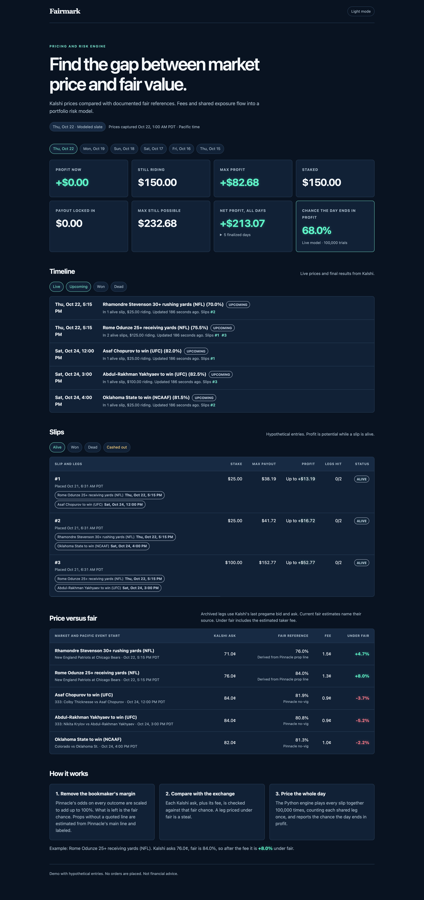

# Fairmark

Fairmark is a pricing and risk engine for sports markets on Kalshi, a federally regulated prediction exchange.

Live: https://fairmark-app.pages.dev



## How it works

- Removes Pinnacle's margin to estimate no-vig fair value.
- Compares that value with Kalshi's ask plus the estimated taker fee.
- Uses Monte Carlo trials to estimate the chance of day profit, sampling shared legs once per trial.

## Stack

Python 3.12 with uv, Cloudflare Pages Functions, Workers KV, and a poller for market updates.

## Run locally

Given a local slate text file:

```bash
uv sync
uv run fairmark slate slate.txt
```

## Tests

```bash
uv run pytest
(cd app && npm test)
(cd live && npm test)
```

## Mobile

 
