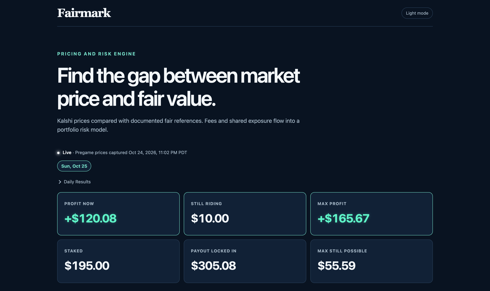
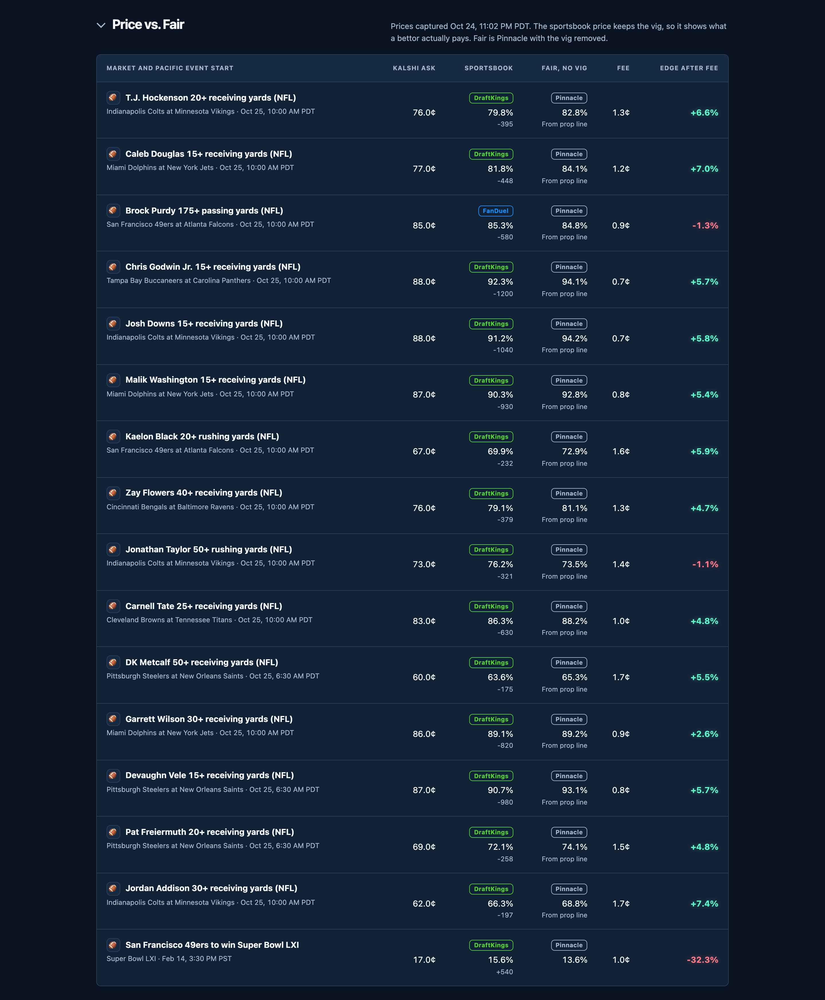
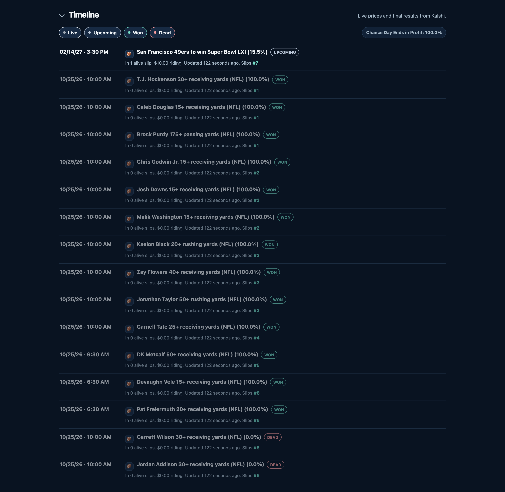
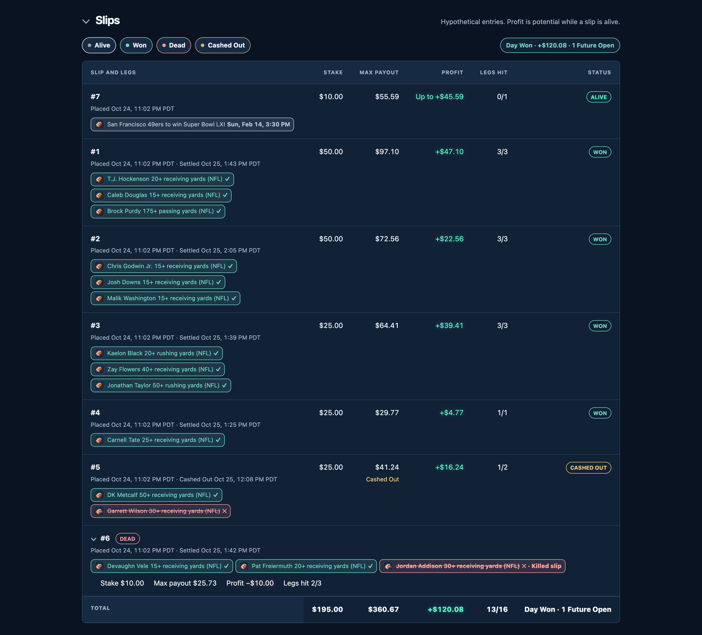
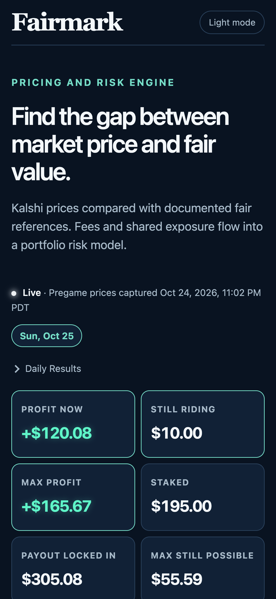
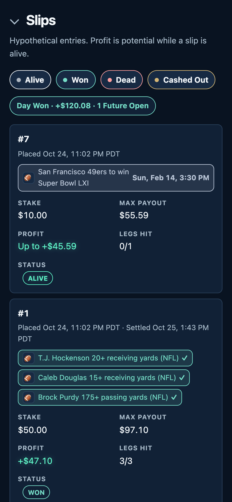

# Fairmark

Fairmark is a pricing and risk engine for sports markets on Kalshi, a federally regulated prediction exchange.

Live: https://fairmark-app.pages.dev



## How it works

- Removes Pinnacle's margin to estimate no-vig fair value.
- Shows what a regular sportsbook charges for the same bet, DraftKings first, then FanDuel, then BetMGM, with the vig left in.
- Compares fair value with Kalshi's ask plus Kalshi's taker fee: edge after fee = (fair − ask − fee) ÷ fair.
- Uses Monte Carlo trials to estimate the chance of day profit, sampling shared legs once per trial.

The demo day is built from one pregame capture of Kalshi and sportsbook prices, so every price on it is real and from before the games started. Results and the cash-out come from Kalshi's own market data.

### Price vs. Fair

Each leg's Kalshi ask next to the sportsbook price and the Pinnacle no-vig fair, with the fee and the edge after fee.



### Timeline

Every leg in start order, with live prices and final results from Kalshi.



### Slips

Won, dead, cashed out and still riding, with a total for the day.



## Stack

Python 3.12 with uv, Cloudflare Pages Functions, Workers KV, The Odds API for sportsbook lines, and a poller for Kalshi market updates.

## Run locally

Given a local slate text file:

```bash
uv sync
uv run fairmark slate slate.txt
```

Market and combo search runs from the command line. For example, put `slip 1 10: Lakers to win, Celtics to win` in `slate.txt`, then run:

```text
$ uv run fairmark slate slate.txt --trials 100000
Fairmark slate | ... Pacific
Leg | Kalshi price (ask) | Bovada odds | Bovada implied % | Pinnacle fair %
Kalshi verification
Estimated slips
Monte Carlo | 100,000 trials | ...
```

The result depends on live matches. Missing fair lines show `N/A` and make the simulation unavailable.

## Tests

```bash
uv run pytest
(cd app && npm test)
(cd live && npm test)
```

## Mobile

 
